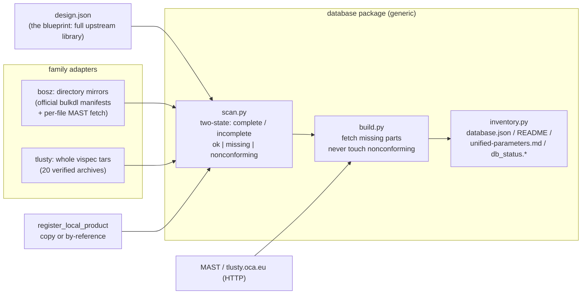

# Architecture

stellarlib gives unified, provenance-first access to theoretical stellar
spectral libraries — model-atmosphere flux grids published on
(Teff, log g, [M/H], ...) parameter nodes. The design follows the
companion package `stellariso` (isochrones): native fidelity first, a
traceable unified layer above it, provenance on every object, data
acquired in the form the source publishes, and no silent fallbacks. The
places where a spectral library is not an isochrone table are called out
below.

## The two layers

**Native layer.** One `NativeSpectrum` per published file: the numeric
arrays exactly as parsed, the verbatim header lines, and the metadata the
filename or header states. Where the format omits a column the attribute
is `None` — BOSZ resam files carry no wavelength (the sidecar grid is a
separate file and a separate, explicit pairing decision); TLUSTY files
carry no continuum. Nothing is renamed, converted, clipped, or filled.

**Unified layer.** A lazy view mapping the native arrays onto a fixed
field vocabulary (`wavelength`, `wavelength_um`, `eddington_flux`,
`surface_flux`, `continuum`) through per-family field specs declared in
the registry. Transformations come from a closed vocabulary — `4 pi * x`,
`x * 1e-4`, `10 ** x` — never free-form code. The air/vacuum wavelength
convention is the product's own and is never converted.

### Where this deliberately differs from stellariso

1. **Cross-node interpolation is a core feature, not a refused
   operation.** stellariso refuses interpolating between isochrones
   because no trusted alignment coordinate exists; a spectral library's
   (Teff, log g, [M/H]) axes exist precisely to be interpolated. Every
   interpolation is therefore audited instead of forbidden: the
   `InterpolationRecord` on `last_record` carries the method, the exact
   corner nodes and their parameter values, the weights, and the clamp
   state.
2. **Lazy node index + materialized side-products.** An isochrone
   product is one file; a spectral library is hundreds to thousands of
   gzip files. A `SpectrumSet` is a lightweight index (coordinates,
   paths, filename facts); spectra materialize on demand and cache on
   the grid. The inverse operation is explicit: `materialize_grid`
   merges a complete-rectangle grid into the array block sparse-matrix
   consumers want, with a sidecar recording every source checksum — the
   block is a derived artifact, the source files remain the truth.

## Grids, holes, and interpolation policy

`grid.axes` reports the values that actually exist — never a declared
rectangle. `grid.holes` lists the cells of the axis-product that have no
published node (about 8.5% of MARCS models are unpublished, mostly at
low log g); holes are reported, never silently filled.

Selection and interpolation are separate decisions:

- **Selection** (`get_spectrum(method=...)`): `exact` fails loudly;
  `nearest` snaps with a warning and a record — as in stellariso.
- **Point queries** (`spectrum(interp=..., range_policy=...)`):
  - an exact node hit returns the published spectrum unchanged
    (`method="exact-node"` — no interpolation happens at all);
  - `interp="multilinear"` (default) interpolates linearly in every
    axis over the bracket cell's 2^N corners — linear in Teff, log g,
    [M/H], matching the libraries' own axis labeling and the downstream
    applications' validated behavior. A holed bracket cell raises
    `GridHoleError`;
  - `interp="voronoi"` answers with the single nearest published node
    (distances step-normalized per axis, so a 250 K Teff step and a
    0.25 dex log g step are comparable). This is the hole-tolerant
    path: it never invents data between nodes, and says so — a
    `VoronoiInterpolationWarning` fires and the record names the node;
  - `range_policy="strict"` refuses out-of-range coordinates (no
    extrapolation); `"clamp"` clamps to the edge cell with a warning
    and a record. The clamped-light fraction of a population is an
    application-level quantity, not the library's.
- **The raw corner mechanism** (`corner_weights` / `corner_spectrum`)
  exposes the rectangular machinery itself: corner order is C order over
  the axes in declaration order (for (teff, log g, [M/H]):
  `c = 4*dt + 2*dg + d*m`; for (teff, log g): `c = 2*dt + d*g`), flat
  indices ravel the axis product, degenerate single-value axes are
  legal (Teff ladders). This is the contract the downstream
  sparse-matrix consumers (and `materialize`) pair with.
- **Wavelength resampling** (`resample_wavelengths`) is linear in
  wavelength, refuses extrapolation, and records itself in provenance —
  the result is a derived product and never masquerades as native.
- The no-transform principle bounds the native layer, not the unified one: what a mirror holds is verbatim, and the transformations the unified structure needs for interpolation are legitimate derived operations — provenance-recorded, never replacing the native data. This is the clause the planned rorig read side rests on: those spectra publish at per-file native samplings with no shared grid, so cross-node interpolation requires an explicit resampling onto a shared wavelength grid, carried out and recorded like every other resample.

Flux interpolation runs in the linear space the libraries publish
(including the upstream-clipped exact-zero rows); quirks are recorded in
the registry notes, never patched in code.

## The local database

The database follows the unified management architecture: a **Product**
is one directory (one whole official package + MANIFEST), a **Part** is
one file (the unit of fetching and judgment), the **Blueprint**
(design.json) is a local record of the complete upstream library — a
family declaration expands to every upstream unit, whole, and has no
partial form. The **Scanner** judges every part (`ok` / `missing` /
`nonconforming`, products `complete` / `incomplete`); the **Builder**
fetches only what is missing and never completes a product that holds
nonconforming parts (a checksum proves integrity, not design
membership). A fetch pass may run with bounded parallelism
(`build_database(workers=N)`) — a speed axis only: per-part atomicity,
manifest recording, and resume semantics are identical. A build run may restrict itself to whole products with
`select=` (glob patterns over product paths) — a fetch-round concern
that never edits the blueprint. An upstream 404 is recorded as a failed fetch attempt
(status, url, time in the MANIFEST) — the part stays missing, shows in
`db_status`, and is retried on the next build; no publication claim is
inferred from an HTTP status (unpublished nodes are known only through
the confirmed family-policy constants and the holes computed from the
files actually held). Everything at the root (`database.json`, `README.md`,
`unified-parameters.md`, `db_status.*`) is regenerated from directory
contents alone, never copied between machines.

A present part with recorded evidence is verified against both recorded
quantities on every scan and build: a size mismatch is nonconforming on
its own (identical bytes cannot have different sizes), and a matching
size still pays the sha256 comparison — size equality never substitutes
for content verification. That comparison is served from the database's
**signature cache** (`signature_cache.json`, built on the
`file_quick_signature` key grammar): each file's quick signature — path
relative to the database root, plus size and mtime_ns — maps to its
sha256, so a file that did not change since its last hash is verified
with one `stat`. Fetch-time streaming hashes and registration hashes
feed the cache, so a freshly built product is never re-read. The cache
is a derived accelerator, never an authority: deleting it is always
safe and forces one full re-verify on the next scan. Keys are relative
to the root, so moving or renaming the database within one machine
keeps the cache valid; there is deliberately no cross-machine
invalidation — after migrating a database to another machine, delete
`signature_cache.json` (an mtime-preserving copy such as `cp -a` or
`tar` transfers content unverified, while a fresh `rsync` verifies by
checksum).

Each family mirrors its upstream exactly at the granularity the source
publishes (the verified facts and scales live in docs/data-sources.md):

- **BOSZ** publishes one directory per (broadening, metallicity) and an
  official bulk-download script per directory — upstream's own manifest
  of that directory's spectra (45,724 at m+0.00; the count differs by
  metallicity, 628,620 in total per broadening). A product is that whole
  directory mirror: the script is fetched first (a designed part, cached
  under its upstream name) and expanded in-build to the complete file
  list. The rorig directories additionally hold the line-identification
  product line, which the official scripts omit: each rorig mirror also
  fetches the directory's own Apache index (cached as
  `directory_index.html`) — the one complete authoritative listing that
  includes the lineid files — and enumerates them from it. The shared
  wavelength grids mirror as their own product and pair automatically
  at grid-open. The blueprint declares all 112 directories.
- **TLUSTY** publishes per-composition vispec tar archives holding both
  spectrum kinds of every atmosphere. A product is one whole tar —
  fetched once, stored verbatim, never extracted; spectra stream from
  its members. The blueprint declares all 20 archives.

Reading a mirror is a selection, never a fetch-side subset: a BOSZ
mirror interleaves every composition and vmicro variant, so opening a
grid picks one composition (`am`/`cm`, default solar-scaled) and the
family-policy vmicro per node, with the choice recorded in the set
notes. Materialization follows the grid, not any declaration:
`materialize_grid` merges the nodes of whatever grid is opened — one
product, one composition — and the mirror on disk always holds more
than any single grid over it.

Products can also enter through `register_local_product` (files you
already hold, or a hand-downloaded vispec tar) — checksummed and
recorded, copy or by-reference.

## Provenance

Every object carries a `Provenance` bundle (source records with trust
classes, data assets with checksums, transformation chains, scientific
vs software references) — the same schema as stellariso, so
cross-package tooling sees one shape. Per-file MAST URLs are recorded
for fetched BOSZ files; registered local products record their
`local_user_file` origin and checksums.
